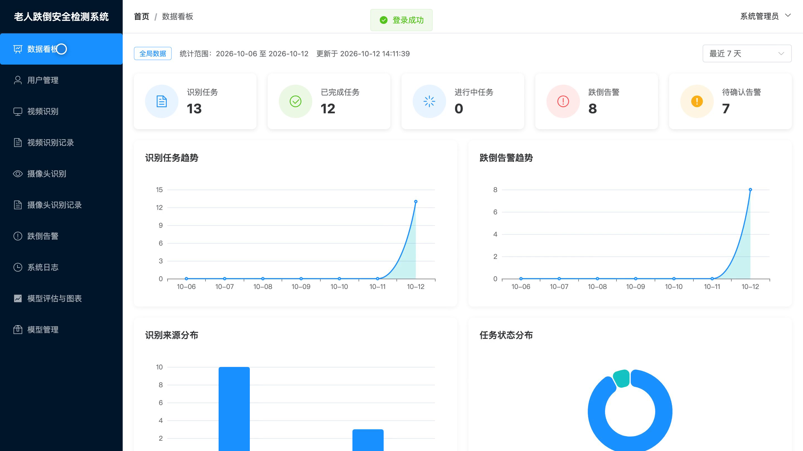
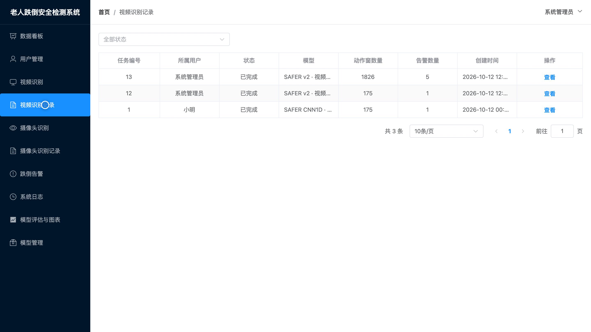
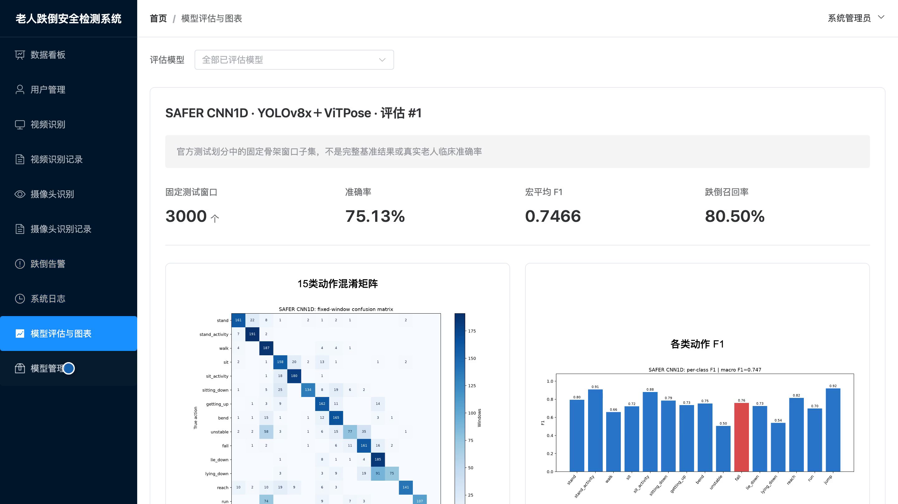
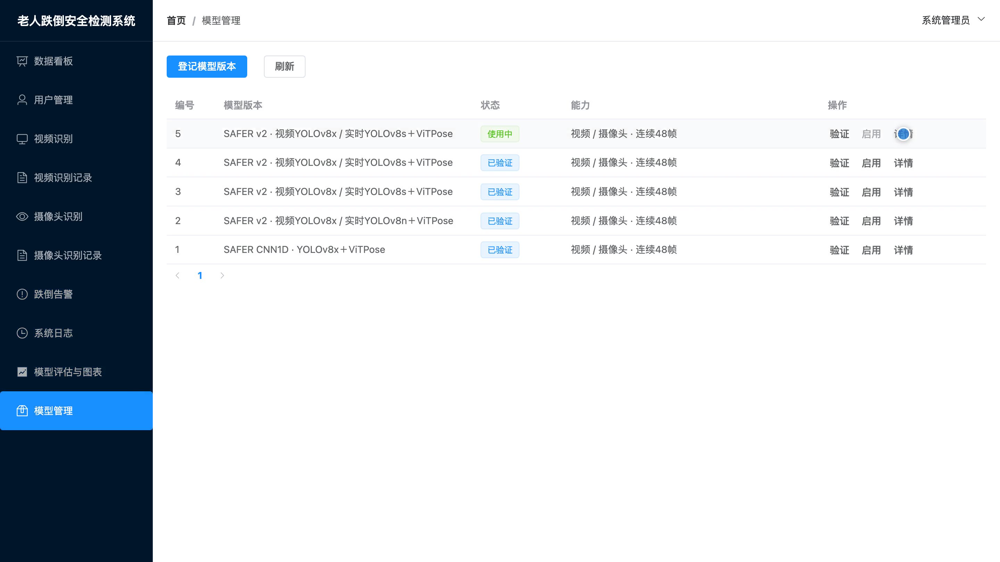
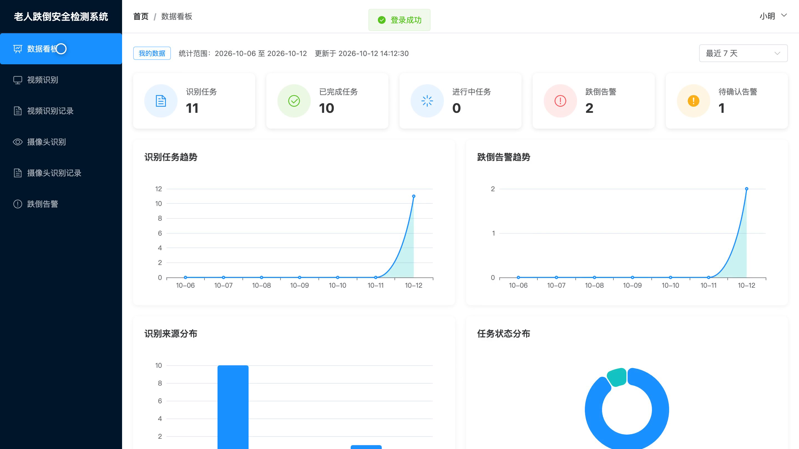
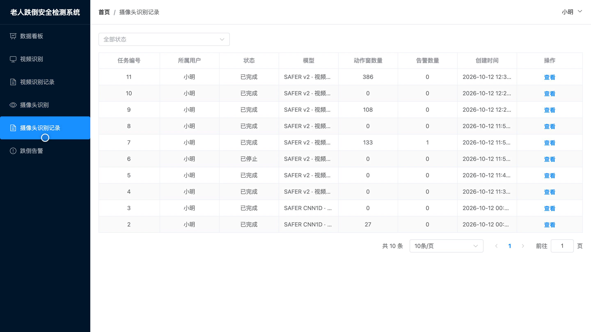
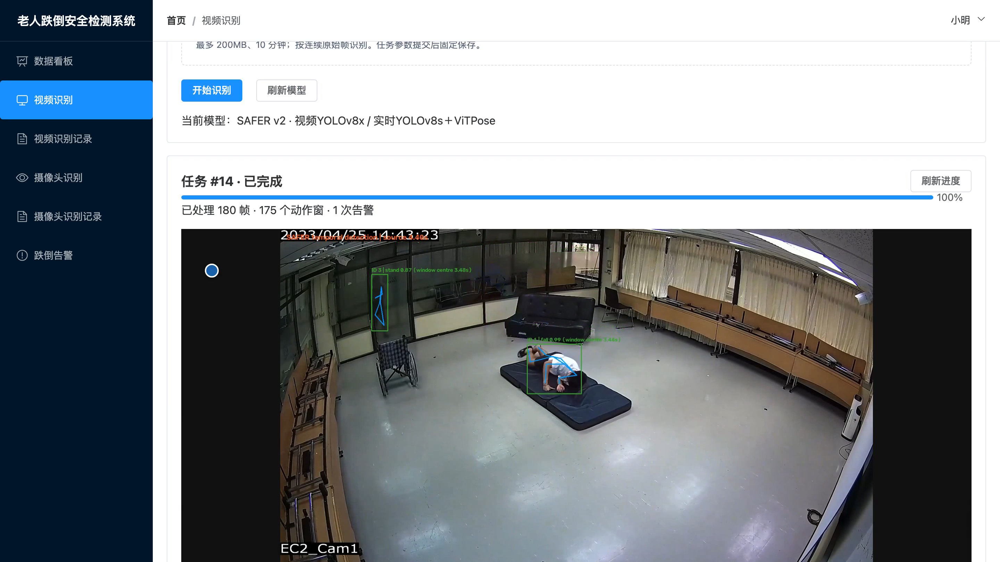

# bs161D
bs161D基于深度学习的老人跌倒安全检测系统源码 Python Django Vue3
## 源码问题查看主页咨询

### 一、关键词
老人跌倒检测、居家养老、智慧看护、异常行为预警、安全监护

### 二、作品包含
源码+数据库+全套环境和工具资源+本地部署教程

### 三、项目技术
前端技术： Html、Css、Js、Vue3.4、Element-Plus
后端技术：Python、Django、DRF、Ultralytics、PyTorch、OpenCV

### 四、运行环境要求
开发工具：PyCharm + VSCODE

数据库：MySQL5.7（共14张表）

数据库管理工具：Navicat10以上版本

环境配置软件： Python3+

前端Nodejs：20.19.5

浏览器：谷歌浏览器

### 五、项目介绍
项目编号：bs161D

本系统面向老人居家看护场景，通过视频和实时摄像头采集连续人体骨架，识别跌倒等动作并生成站内告警。系统保存检测记录、标注视频、现场截图和参数快照，支持回看告警并登记处理结果，方便用户日常监护和管理员统一管理。

角色：用户、管理员

用户功能：本人数据看板、视频与摄像头动作识别、本人识别记录查询与回看、跌倒告警查看及处理、个人信息与密码维护。

管理员功能：全局检测数据看板、用户账号与角色管理、视频与摄像头动作识别、全局识别记录查询与回看、跌倒告警处理及追溯、系统日志查询、模型版本管理与评估图表、个人信息与密码维护。

### 六、运行截图

